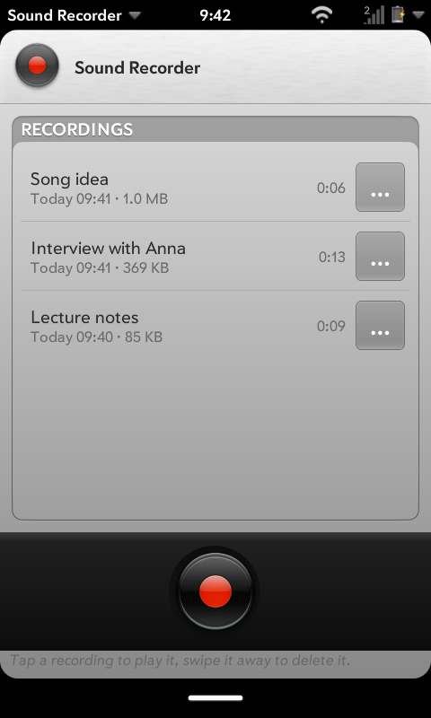
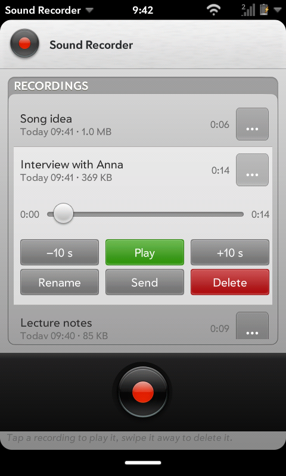
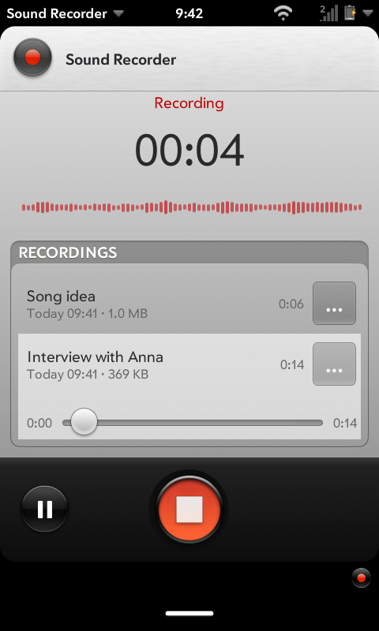
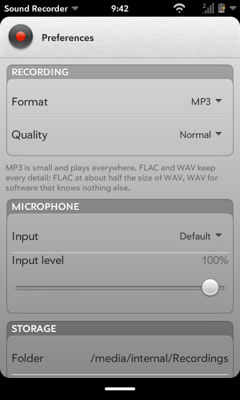

Sound Recorder
==============

Records from the microphone, and plays, renames, sends and deletes what was
recorded. A QML app for LuneOS in the LuneOS style (LuneOS.Forms), with the
legacy webOS camera's record and stop buttons, redrawn as vectors.

Screenshots
-----------

Taken on a device with `tools/screenshots.sh`: the recordings, a
recording's player, recording (with its dashboard in the notification area
at the bottom right) and the preferences.

**Phone, 480x800** (mindphone)

| Recordings | Player | Recording | Preferences |
|---|---|---|---|
|  |  |  |  |

Features
--------

- **Record** with the camera's record button; it turns into stop. Pause and
  resume; the paused time is left out of the file.
- **While recording:** the time, big, and the microphone's level as a strip
  that scrolls by. A dashboard in the notification area shows the time with
  Pause and Stop; its icon is the record button. The recording carries on
  with the card in the background or closed, and the device does not
  suspend until it is stopped (a sleepd activity, renewed every 5 minutes).
- **Recordings,** newest first, with when, how big and how long; a search
  box once there are six or more. Tap one to open its player in place: seek,
  -10 s, play/pause, +10 s.
- **Rename, Send by Email, Details, Delete** from the row's "…" button or
  touch and hold. **Swipe a recording away** to delete it: the row asks
  Delete / Cancel in place, as the legacy webOS lists did. Renaming never
  replaces another recording.
- **Preferences** (app menu): format (MP3, FLAC, WAV), quality, input and
  input level; the folder and the free space.
- **Privacy switch:** with the microphone switched off
  (org.webosports.service.killswitch) the app says so and does not record,
  and stops a running recording, keeping what it has.
- **Launch parameters:**
  - `{"action": "record"}` starts recording at once and `{"action": "stop"}`
    stops it - for a shortcut or Just Type;
  - `{"target": "<file>"}` opens that recording's player, as the Files app
    opens a file (only recordings in the app's folder);
  - `{"page": "preferences"}` opens the preferences.
- **Sharp at any size:** the buttons, the bezel and the icons are SVG,
  redrawn from the legacy camera's bitmaps and measured against them
  (`tools/vectorize`).

Recordings are files in `/media/internal/Recordings`, named
"Recording 2026-10-15 06.30.12.mp3" until renamed.

What it does not do, and why
----------------------------

Measured on the mindphone and the TouchPad, 2026-10-15:

- **No AAC/M4A, Ogg Vorbis or Opus.** Qt Multimedia's GStreamer backend
  picks gst-droid's AAC encoder, which fails to start; asking for Vorbis or
  Opus gives Ogg FLAC. MP3, FLAC and WAV come out as asked.
- **No mono.** The same backend records two channels whatever
  `MediaRecorder.audioChannelCount` says.
- **The level meter may stay hidden.** It listens on a second stream; the
  TouchPad's droid source gives that stream nothing while the recorder runs,
  and the strip then does not appear rather than suggesting a dead
  microphone. A second stream at another sample rate even left the
  TouchPad's recordings empty, so the meter uses the input's own format.
- **No "keep the screen on".** The card shell has no window property for it.

Tested on
---------

Recording in all three formats, checked file by file (`tools/test-device.sh`),
on 2026-10-15:

| Device | Architecture | Screen |
|---|---|---|
| mindphone | armv7 | 480x800 |
| HP TouchPad | armv7 | 1024x768 |
| Q25 | aarch64 | 720x720 |

How it fits together
--------------------

- `qml/main.qml`: the window - recorder, preferences, the bus (sleepd, the
  privacy switch, Email), the dashboard, the launch parameters.
- `qml/Recorder.qml`: Qt Multimedia's CaptureSession and MediaRecorder,
  thrown away and made again after an error (a failed GStreamer pipeline
  stays failed).
- `qml/RecordingsPage.qml`, `qml/components/RecordingRow.qml`: the list,
  the player, swipe to delete. `qml/PreferencesPage.qml`.
- `qml/js/Recordings.js`: names, formats, times - no QML, unit-tested.
- `SoundRecorderApp/`: the C++ QML plugin for what QML cannot do:
  `FileOperations` (list, rename without replacing, delete - confined to the
  recordings folder) and `LevelMeter` (QAudioSource, peak per buffer).
- `qml/images/*.svg`, `icon.png`: the legacy camera's buttons as vectors;
  see [tools/vectorize/README.md](tools/vectorize/README.md).

Building
--------

CMake with the webOS modules, as every LuneOS app; needs Qt 6 Qml and
Multimedia. For development on a device:

    cmake -S . -B build/arm -G Ninja -DCMAKE_TOOLCHAIN_FILE=<recipe workdir>/toolchain.cmake \
        -DQT_HOST_PATH=<recipe workdir>/recipe-sysroot-native/usr && ninja -C build/arm
    tools/install.sh build/arm <adb serial>      # an ipk through appInstallService
    tools/test-device.sh <adb serial> <name>     # records in each format and checks the files
    tools/screenshots.sh <adb serial> <name>     # the screenshots above

Tests
-----

See [tests/README.md](tests/README.md): QML tests of the helpers and of the
pages on the build host, gtest unit tests of the plugin, static analysis,
sanitizers, valgrind, a six-way build, and the recording test on a device.
The artwork tools have their own (`tools/vectorize/README.md`).
