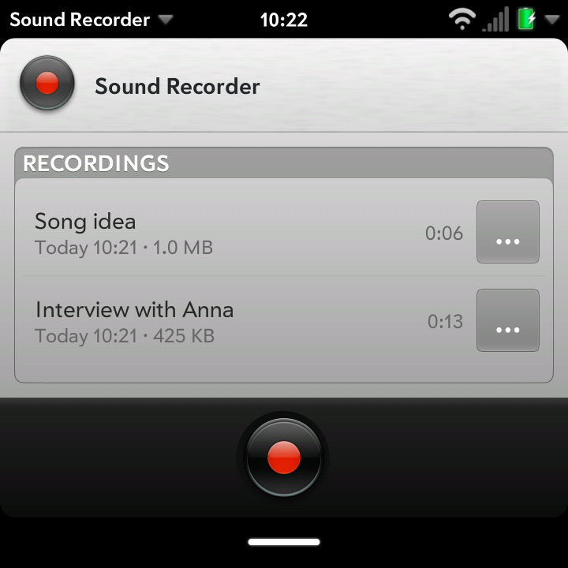
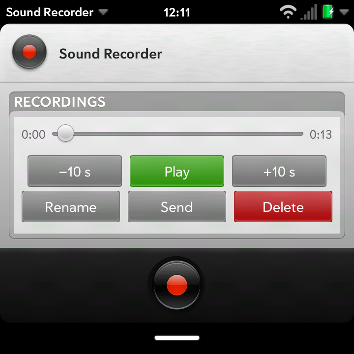
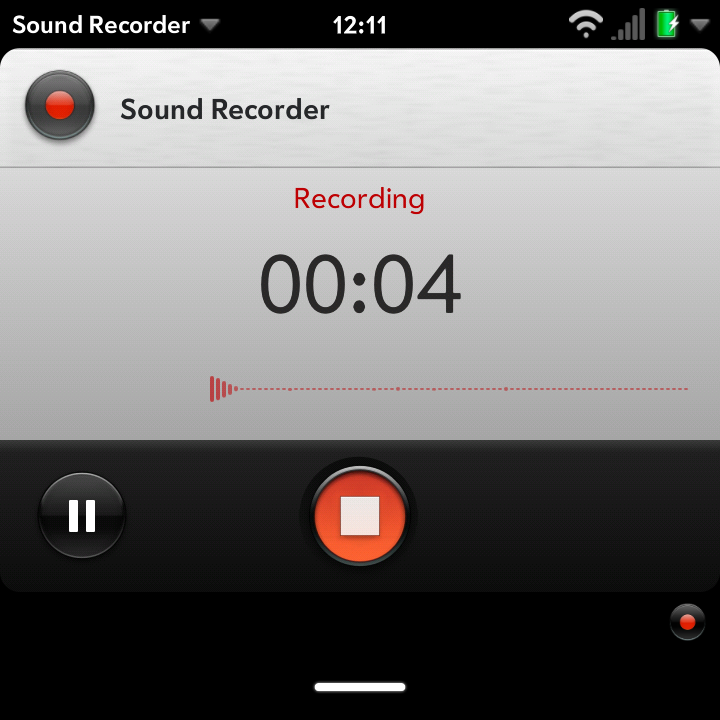
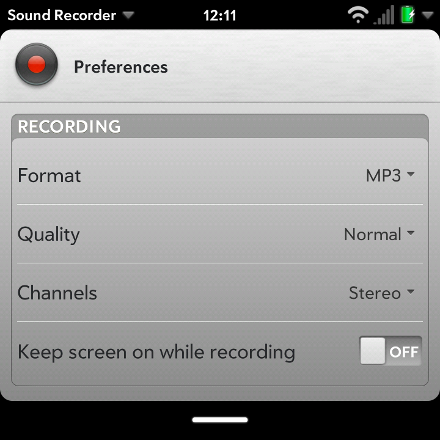
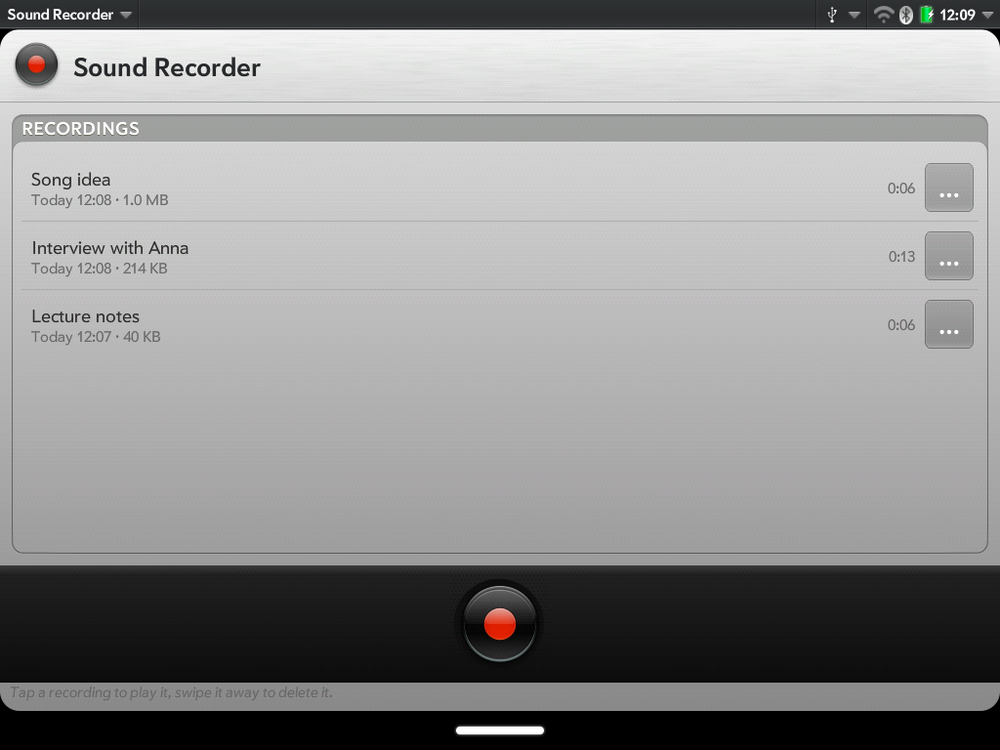
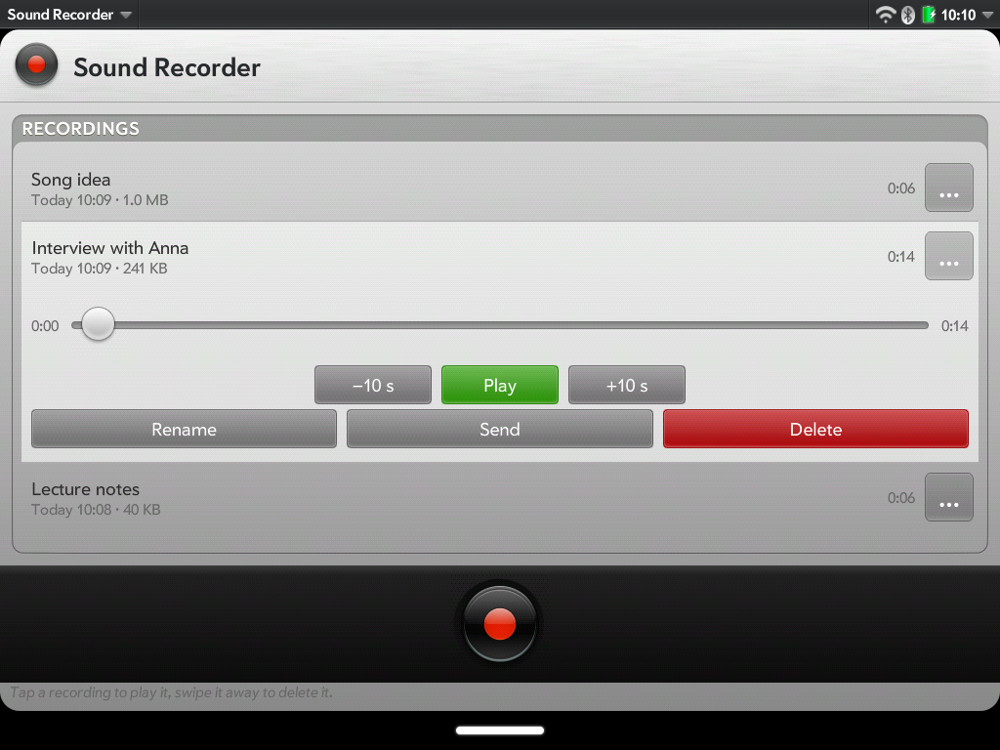
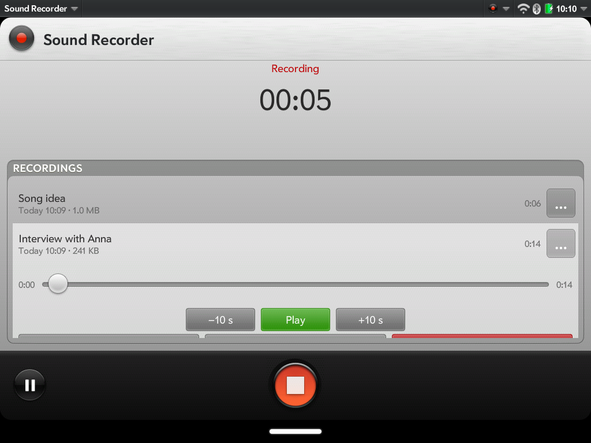
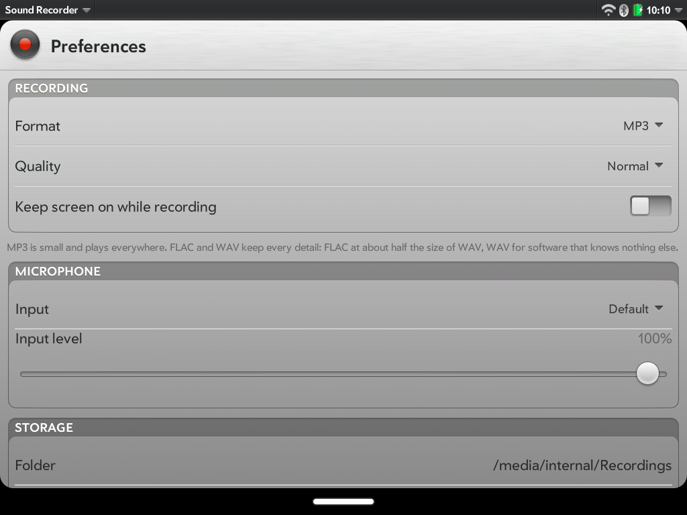

Sound Recorder
==============

Summary
-------
Records from the microphone, and plays, renames, sends and deletes what was recorded.

A QML app for LuneOS in the LuneOS style (LuneOS.Forms), with the legacy
webOS camera's record and stop buttons, redrawn as vectors.

Screenshots
-----------

Taken on the devices with `tools/screenshots.sh`: the recordings, a
recording's player, recording (with its dashboard in the notification area
at the bottom right) and the preferences.

**Phone, 480x800** (mindphone)

| Recordings | Player | Recording | Preferences |
|---|---|---|---|
|  |  |  |  |

**Square, 720x720** (Q25). There is no room for the list under the
recording panel here, so while recording the panel has the page to itself.

| Recordings | Player | Recording | Preferences |
|---|---|---|---|
|  |  |  |  |

**Tablet, 1024x768** (HP TouchPad). Its microphone gives the level meter
nothing while recording (see below), so the meter is left out.

| Recordings | Player |
|---|---|
|  |  |
| **Recording** | **Preferences** |
|  |  |

Features
--------

- **Record** with the camera's record button; it turns into stop. Pause and
  resume; the paused time is left out of the file.
- **While recording:** the time, big, and the microphone's level as a strip
  that scrolls by. A dashboard in the notification area shows the time with
  Pause and Stop; its icon is the record button. The recording carries on
  with the card in the background or closed, and the device does not
  suspend until it is stopped (a sleepd activity, renewed every 5 minutes).
- **Recordings,** newest first, with when, how big and how long; a search
  box once there are six or more. Tap one to open its player in place: seek,
  -10 s, play/pause, +10 s.
- **Rename, Send by Email, Details, Delete** from the row's "…" button or
  touch and hold. **Swipe a recording away** to delete it: the row asks
  Delete / Cancel in place, as the legacy webOS lists did. Renaming never
  replaces another recording.
- **Preferences** (app menu): format, quality, stereo or mono (see
  [Recording formats](#recording-formats)), input and input level, and
  whether to keep the screen on while recording (off by default;
  luna-displaymanager's `requestBlock`); the folder and the free space.
- **Privacy switch:** with the microphone switched off
  (org.webosports.service.killswitch) the app says so and does not record,
  and stops a running recording, keeping what it has.
- **Launch parameters:**
  - `{"action": "record"}` starts recording at once and `{"action": "stop"}`
    stops it - for a shortcut or Just Type;
  - `{"target": "<file>"}` opens that recording's player, as the Files app
    opens a file (only recordings in the app's folder);
  - `{"page": "preferences"}` opens the preferences.
- **Sharp at any size, quick to load:** the buttons, the bezel and the
  icons are SVG, redrawn from the legacy camera's bitmaps and measured
  against them (`tools/vectorize`). They are shown through LuneOS.Components'
  `ArtworkImage`, which draws each once at the size shown and keeps it as
  PNG (`/var/cache/xdg/luneos-components/artwork`), so later starts load
  PNGs rather than drawing SVG.

Recordings are files in `/media/internal/Recordings`, named
"Recording 2026-10-15 06.30.12.mp3" until renamed.

Recording formats
-----------------

Pick one in Preferences, with the quality and stereo or mono; they apply
to the next recording. MP3 is the default. Only the formats Qt Multimedia
can write on the device are offered.

| Format | File | Size at Normal, about | Good for |
|---|---|---|---|
| **MP3** | `.mp3` | 0.6 MB a minute | everyday use; plays everywhere |
| **AAC** | `.m4a` | 1 MB a minute | plays nearly everywhere |
| **Ogg Vorbis** | `.ogg` | 0.65 MB a minute | an open format |
| **Opus** | `.opus` | 0.4 MB a minute | the smallest; an open format |
| **FLAC** | `.flac` | 1-2 MB a minute | keeping every detail at a fraction of WAV's size |
| **WAV** | `.wav` | 10.6 MB a minute | software that takes nothing else |

Recordings are 44.1 kHz (Opus: 48 kHz; WAV: 16-bit), stereo unless mono
is chosen. **Quality** (Low, Normal, High, Very high; not for FLAC and
WAV) sets MP3's and Ogg Vorbis's variable bit rate and AAC's and Opus's
bit rate; Normal is each encoder's own default. MP3 at Low came out at 42
kbit/s, at Very high at 109 kbit/s.

The sizes were measured on the mindphone in a quiet room; MP3's, Ogg
Vorbis's and FLAC's grow with louder, busier sound. FLAC files from this
recorder carry no length in their header: Sound Recorder keeps the length
itself, but another player may not show it until it has read the whole
file.

What it takes from LuneOS:

- **AAC** is encoded with libav's encoder: the app ranks it above
  gst-droid's, which fails to start on the devices tried
  (`SoundRecorderApp/encoderranks.h`).
- **Opus** needs GStreamer's `opusenc` (gst-plugins-base built with
  `opus`); without it the app does not offer Opus.
- **Quality and mono** need LuneOS's Qt Multimedia patch that hands them
  to the encoder (`0006-gstreamer-mediarecorder-apply-the-audio-settings-to-the-encoder.patch`
  in meta-luneos); without it every recording is stereo at the encoder's
  defaults, whatever is chosen.

What it does not do, and why
----------------------------

Measured on the mindphone and the TouchPad, 2026-10-15:

- **The level meter may stay hidden.** It listens on a second stream; the
  TouchPad's droid source gives that stream nothing while the recorder runs,
  and the strip then does not appear rather than suggesting a dead
  microphone. A second stream at another sample rate even left the
  TouchPad's recordings empty, so the meter uses the input's own format.

Tested on
---------

Recording in each format, each file checked for its format, for sound
and for its length (`tools/test-device.sh`), on 2026-10-15:

| Device | Architecture | Screen | Formats |
|---|---|---|---|
| mindphone | armv7 | 480x800 | MP3, AAC, Ogg Vorbis, Opus, FLAC, WAV; mono; quality |
| HP TouchPad | armv7 | 1024x768 | MP3, FLAC, WAV |
| Q25 | aarch64 | 720x720 | MP3, FLAC, WAV |

How it fits together
--------------------

- `qml/main.qml`: the window - recorder, preferences, the bus (sleepd, the
  privacy switch, Email), the dashboard, the launch parameters.
- `qml/Recorder.qml`: Qt Multimedia's CaptureSession and MediaRecorder,
  thrown away and made again after an error (a failed GStreamer pipeline
  stays failed).
- `qml/RecordingsPage.qml`, `qml/components/RecordingRow.qml`: the list,
  the player, swipe to delete. `qml/PreferencesPage.qml`.
- `qml/js/Recordings.js`: names, formats, times - no QML, unit-tested.
- `SoundRecorderApp/`: the C++ QML plugin for what QML cannot do:
  `FileOperations` (list, rename without replacing, delete - confined to the
  recordings folder) and `LevelMeter` (QAudioSource, peak per buffer).
- `qml/images/*.svg`, `icon.png`: the legacy camera's buttons as vectors,
  shown with `ArtworkImage` (`qml/components/ArtworkButton.qml`); see
  [tools/vectorize/README.md](tools/vectorize/README.md).

Building
--------

CMake with the webOS modules, as every LuneOS app; needs Qt 6 Qml and
Multimedia. For development on a device:

    cmake -S . -B build/arm -G Ninja -DCMAKE_TOOLCHAIN_FILE=<recipe workdir>/toolchain.cmake \
        -DQT_HOST_PATH=<recipe workdir>/recipe-sysroot-native/usr && ninja -C build/arm
    tools/install.sh build/arm <adb serial>      # an ipk through appInstallService
    tools/test-device.sh <adb serial> <name>     # records in each format and checks the files
    tools/screenshots.sh <adb serial> <name>     # the screenshots above

Tests
-----

See [tests/README.md](tests/README.md): QML tests of the helpers and of the
pages on the build host, gtest unit tests of the plugin, static analysis,
sanitizers, valgrind, a six-way build, and the recording test on a device.
The artwork tools have their own (`tools/vectorize/README.md`).
